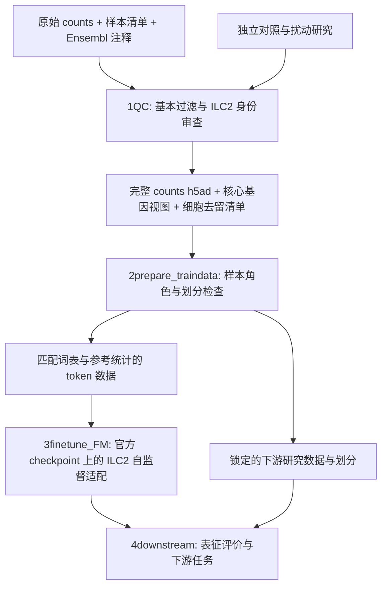

# ILC2 表征模型与扰动分析项目

代码规范以 [AGENTS.md](AGENTS.md) 为准：默认Ponytail full，优先复用、最小实现，只保留输入边界和关键结果检查。禁止为未来需求增加通用框架、过度防御或冗余验证。

更新日期：2026-10-13。以本文件中的四阶段流程为当前开发规范；早期课题设想保留在 `ILC2_rotation_proposal/`，其中尚未核实的样本数或任务可行性不能视为已完成结果。

## 目标与当前状态

在官方 GeneCompass checkpoint 上，以独立的稳态小鼠 ILC2 继续自监督训练（post-training），得到 ILC2 表征模型；再使用独立的处理/基因扰动数据开发下游任务。先评估数据能支持什么，再决定下游网络和输出维度。

稳态训练集允许组织内的基础激活、修复及增殖状态。正常数据不是 GeneCompass 的普遍要求，而是本项目为保留下游处理研究、明确泛化评价而选择的设计。骨髓与外周成熟 ILC2 分开审查，骨髓细胞不自动视为全部前体。

| 阶段 | 入口 | 当前实现状态 |
|---|---|---|
| 基本 QC + ILC2 身份筛选 | `src/1QC.py` | 基础 QC 已实现；GSE117567 身份筛选已由 main/build_train_gse117567.py 完成，通用身份入口待整合 |
| 合并、划分、GeneCompass 编码 | `src/2prepare_traindata.py` | 已定义输入输出，待实现 |
| 加载 checkpoint 并继续训练 | `src/3finetune_FM.py` | 已定义输入输出，待实现 |
| 表征评价、基因删除及监督扰动任务 | `src/4downstream.py` | 已定义输入输出，待实现 |

现有 `main/qc_gse117567.py` 已实际运行：35,396 个原始细胞，初步 QC 35,205，保守排除 5 个 ILC3-like 候选后 35,200；另外 1,775 个其他谱系可疑细胞保留并标记。它使用 ≥500 基因、≥1,000 UMI、mt<15%，尚未完成下面的新 GeneCompass 基础 QC、biotype/core gene 核验和双细胞检测。29,603 个无现有谱系/ILC3 信号标记的外周细胞也只是待复核候选池。

## 整体流程



下游测试研究（包括其 control）不得参与 post-training、post-training 验证选模或下游参数拟合。允许在最终推理时将测试 control 输入已锁定模型。研究角色应在 QC 前指定，细胞级文件列表在 QC 后落实。

## 1. 1QC.py：基础 QC 与高可信 ILC2 筛选

实现接口：`read_10x_sample`、`read_gene_annotation`、`qc_sample`、`select_reviewed_ilc2`，见 `src/qc_utils.py`。前两项载入 counts/注释，qc_sample 返回 full/core/decisions/summary；身份选择函数只接受已经复核的 ILC2/high 标签，不自动产生标签。通过 `python src/1QC.py --basic` 可逐样本运行基础 QC。

### 输入

原始计数矩阵和元数据、`data/metadata/sample_manifest.tsv`、版本固定的 Ensembl 注释、checkpoint 对应核心基因列表、`configs/1QC.json`。无法取得真实 biotype/core 列表时应明确停止正式模型数据导出，不能靠基因名称推测 biotype。

### A. GeneCompass 基础过滤

以下为本项目明确选择的 paper-based preset，不等同于官方示例代码的逐行复刻。

| 项目 | 本项目保留条件 | 统计说明 |
|---|---|---|
| 检出基因数 | ≥200 | 在原始全基因 counts 上统计 count>0 |
| 样本细胞数 | ≥4 | 每个真实输入文库独立检查；过滤后再次检查 |
| 蛋白编码或 miRNA 检出数 | ≥7 | 两类基因的并集，每个基因只计一次 |
| 线粒体比例 | ≤15% | 原始线粒体 counts / 原始全部 counts；不能先删基因再计算 |
| 检出基因数异常上限 | 不超过样本均值 +3 SD | 每个输入样本在所有非空细胞上、基础 QC 前计算；总体 SD（ddof=0）；SD=0 时不做该项 |
| 模型核心基因 | 在固定核心列表中 | biotype 允许 protein_coding、lncRNA、miRNA；与 checkpoint 词表的交集在阶段 2 核验 |

**必须纠正的来源矛盾：**论文 Methods 写“过滤超过 7 个 protein-coding/miRNA 基因的细胞”；官方 `gene_number_filter` 实际保留 `count_nonzero >6`，即至少 7 个。本项目采用代码所支持的方向，绝不删除所有超过 7 个这类基因的正常细胞。官方 `normal_filter` 示例使用 UMI 总量及 mt 比例的双侧 ±3 z-score，而非上述检出基因数上限；两种方案不能静默混用。

核心列表应记录物种、基因组/Ensembl release、biotype 映射、来源、SHA256。旧版 lincRNA/antisense 等注释是否归入 lncRNA，须按所选版本的映射表处理。Ensembl ID 版本后缀、重复 ID、同源基因及 symbol 映射须可追溯。

先保存完整原始矩阵及细胞去留信息，再导出核心基因视图；“删除非核心基因”只作用于模型视图，不抹掉原始记录。输入文库少于 4 个细胞与最终 ILC2 子集少于 4 个细胞分别记录；这些细胞数不能当作生物重复数。

### B. ILC2 身份与质量审查

按组织/文库聚类，结合原始分选方式和多个基因程序判定。优先查看 Gata3/Rora，ILC 背景 Il7r/Thy1/Id2，辅助受体 Il1rl1/Il17rb/Icos/Klrg1，以及 Il5/Il13/Areg/Arg1 等状态特征。不得要求所有 marker 同时检出，不要求所有组织 ST2 阳性，也不要求骨髓 Il5/Il13 阳性。

替代谱系检查：T（Cd3d/e/g）、NK/ILC1（Ncr1/Nkg7/Eomes/Tbx21/Prf1）、ILC3（Rorc/Il23r/Il22/Il17a/f/Ccr6）、B/髓系，以及内皮/上皮/基质成套 marker。单一 Rorc、Ccr6、Kit 或 Nkg7 阳性不足以删除。按文库运行双细胞检测并结合谱系共表达复核；环境 RNA 校正只在输入数据支持且有理由时增加。

输出分类：高可信外周 ILC2、身份模糊 ILC、骨髓成熟度待复核、其他谱系、疑似双细胞、低质量。主 post-training 集优先高可信外周 ILC2；模糊状态和骨髓通过复核后进入独立扩展集。功能状态与细胞身份分开，增殖/基础激活不自动剔除。

### 训练、验证、测试的要求

基础 QC 使用一致且可复现的规则；验证/测试优先提高身份确认、来源独立性、真实重复和条件注释要求。阶段 3 内部验证用于选模，最终测试不能用于调阈值或选择模型。

如需更严格的 QC（例如 ≥500 基因、mt≤10%），必须预先指定为严格子集，同时报告共同基础 QC 与严格子集上的结果、每个组织/条件的保留比例。不能根据测试结果反复调门槛。更严格不一定更真实，可能偏向高 RNA/低应激状态并改变处理效应。

### 输出

- `data/processed/<study>/full_counts_qc.h5ad`：QC 通过的完整基因对象，保留整数 `layers['counts']`。
- `data/processed/<study>/ilc2_core_counts.h5ad`：身份通过的模型核心基因视图。
- 所有原始细胞的 `cell_decisions.tsv.gz`：QC 原因、身份置信度、doublet flag、训练层级和保留状态。
- `results/<run>/`：样本统计、marker 表、图、参数、注释审查、来源与版本日志。

## 2. 2prepare_traindata.py：构建模型样本集合

### 输入与检查

使用阶段 1 的 counts、细胞清单、样本角色、配套 token 词表/参考中位数/同源映射和 `configs/2prepare_traindata.json`。

统一为 cell×gene 稀疏矩阵和稳定 Ensembl ID；每个细胞使用 study:sample:barcode 唯一标识。不能将重复 symbol 加后缀后当成新基因 token；不同 study 的相同 barcode 不代表同一细胞。统一物种、计数语义与注释版本，处理重复下载的文库，并记录映射失败、丢失基因/UMI、序列截断比例和关键 ILC2 基因覆盖率。

原始全基因 counts、Scanpy log1p/HVG 表达、模型核心 counts、token 序列分别保存。GeneCompass 输入不使用 VST/TMM、HVG-only、z-score 或 Harmony 校正表达。组织与文库混杂时不直接消除组织信号；组织元数据用于分层抽样与评价，未经架构修改不得凭空增加 Tissue token。

### 划分与编码

- `posttrain_train` / `posttrain_val`：优先按独立文库或研究；仅 GSE117567 时细胞留出只能称内部验证，组织留出是组织迁移检查。
- `representation_test`：独立 ILC2 表征测试，选模前锁定。
- `downstream_train` / `downstream_val` / `downstream_test`：按 study/animal/pool/条件组合划分。共享 control 的处理必须成组管理。
- 划分角色互斥；测试研究 control 与 case 一并隔离。统计拟合与特征筛选仅使用允许的训练来源；未知动物 ID 不伪造。

编码严格对应 checkpoint：基因 ID、配套处理后的表达值、排序、2048 截断、padding、有效 length、species（mouse=1）。参考中位数必须取 checkpoint 配套资产或在明确声明的新方案下仅由训练来源估计，不能用测试数据重算。官方示例的每细胞归一化被注释，不能在未核实前随意替换成 Scanpy normalize_total。

输出 `data/prepared/<dataset_version>/`：Hugging Face dataset，各 split 的细胞映射/样本来源、词表与预处理版本、coverage 报告、数据 hash。长度必须与原 dataset 行逐一对应，不可以仅把长度排序后当作逐行长度。训练抽样兼顾组织/样本，不能把大文库内细胞数量当独立实验数量。

## 3. 3finetune_FM.py：ILC2 自监督适配

输入为阶段 2 的 train/val 和匹配的官方 checkpoint、config、token/先验资产、`configs/3finetune_FM.json`。先核实所有资产为实际二进制而非 Git LFS 指针，检查词表 ID、模型维度和缺失/多余权重。

必须加载官方权重；官方 pretraining 示例默认直接构造随机模型，不能仅替换数据目录。先保留原始模型基线，在真实小批次上验证前向、损失、反向、保存/重载和 cell embedding，再执行训练。

目标沿用原模型的 masked gene ID 与 expression 恢复；只对有效 masked positions 计算损失。起步冻结大部分参数、更新最后少量层；学习率、warm-up、epoch 按本项目实际更新步数设定，并使用内部验证早停。Small 先做资源试跑，是否使用 Base 由实测决定。现有 Mac CPU/MPS 测试仅为小型随机模型，不代表正式 checkpoint 的训练资源已验证。

输出 `model/posttrained/<run>/`：权重、config、资产来源/hash、训练数据版本、超参数、训练/验证日志、原始与适配模型的同条件比较。目标是 ILC2 表征适配，不宣称已学会任意扰动响应。

## 4. 4downstream.py：评价与下游任务

输入锁定模型、独立数据及 `configs/4downstream.json`。任务按证据分层执行：

| 任务 | 输入与输出 | 数据要求与结论边界 |
|---|---|---|
| 表征评价 | ILC2 counts → cell embedding、状态/注释迁移 | 比较 PCA、原始 GeneCompass、post-trained 模型；检查 study/tissue 混杂 |
| in silico 基因删除 | 删除目标 token → 基因/细胞 embedding 偏移与候选相关基因 | 可从正常 ILC2 启动；是模型敏感性分析，不是经过真实 KO 验证的表达响应 |
| 监督扰动/KO 预测 | 匹配 control 表征＋扰动编码 →表达 delta 或固定功能程序 delta | 必须有真实处理数据、可追溯独立重复和合理留出；无数据时不能声称完成预测 |
| sc→bulk 外部评价 | 单细胞预测按 sample/pool 聚合 → pseudobulk 响应与纯化 ILC2 bulk 比较 | 确认物种/组织/条件/时间匹配，比较研究内变化量；组织 bulk 不直接当纯 ILC2 真值 |

监督任务先实现零变化、平均响应、Ridge/单刺激相加基线，再考虑小型 MLP 或新网络。正常单细胞训练与处理细胞通常不一一配对，不构造任意的伪配对。未见单扰动和未见组合分别报告；没有可迁移扰动先验及数据证据时，不承诺任意新刺激零样本预测。

评价包括 delta 误差、响应方向、预先固定程序/基因集、独立样本误差和标签置换；全基因 Pearson 只能作辅助。基因集/HVG/DEG/阈值不得根据最终测试结果选择。bulk/pseudobulk 推断以真实生物重复为单位，技术重复需合并，sc 细胞数不能扩大统计 n。

输出 `results/<run>/` 的指标、逐样本预测、图、失败范围及候选机制；模型预测与文献已证明机制明确区分。

## 数据与文件约定

样本清单至少包含 study、sample、species、tissue、condition、原始路径/格式、biological_rep、animal_or_pool、source_url、role、split、annotation_release。未知字段使用 not_available/unassigned，不填猜测值。

AnnData 至少保留 sample/study/tissue/condition、真实生物重复信息、QC、annotation、identity_confidence、training_tier、split；var 保留 Ensembl ID、symbol、biotype、core/token 映射标记。实际注释版本缺失时不能声称已完成 core 验证。

```
ILC2_model/
├── README.md / CLAUDE.md / .gitignore
├── environment.yml / requirements.txt / requirements-lock.txt
├── configs/                  # 四阶段配置，当前为设计参数
├── src/                      # 正式四阶段入口及工具库
├── main/                     # 探索脚本、历史脚本和 notebook
├── data/
│   ├── GSE117567_RAW/         # 已有原始文件，保留旧路径
│   ├── raw/                  # 后续研究原始数据
│   ├── metadata/             # 可提交的样本清单及划分记录
│   ├── references/           # Ensembl/core/token 等外部资产
│   ├── processed/            # QC/身份筛选后的 counts
│   └── prepared/             # 模型输入与 split 数据
├── model/                    # pretrained / posttrained / downstream
├── external/                 # 官方源码本地 checkout，不纳入项目提交
├── results/                  # 运行目录、统计、图、报告
├── notebooks/                # 交互分析
├── tests/                    # 骨架/数据接口检查
├── docs/                     # 设计依据与开发记录
└── ILC2_rotation_proposal/    # 已有提案与数据审计资料
```

提交代码、配置、样本级 metadata、报告与小型汇总；原始矩阵、h5ad、逐细胞大表、模型权重、token 大文件和第三方源码由 .gitignore 排除，下载来源与 hash 单独记录。不要把环境绝对路径、密钥或用户个人信息写入公开配置。开源 LICENSE 待项目负责人确定，不自动替第三方数据或代码声明授权。

## 开发顺序与完成标准

1. 基础 QC 已实现；下一步补充高可信 ILC2 注释与训练/验证共同及严格子集报告。
2. 补齐 checkpoint 对应资产与 Ensembl 注释，完成 2prepare_traindata 的 coverage、去重及无泄漏检查。
3. 完成正式 checkpoint 小批次测试，比较原始表征后进行 3finetune_FM。
4. 先完成独立表征评价和 in silico 敏感性分析，再按扰动数据质量落实监督任务。

每步只有在输出、参数、来源与检查记录齐备时才标记完成。不得把 CLI --help 成功、未实现骨架或随机模型自检写成真实训练成功。

## 来源与协作原则

- [GeneCompass 论文](https://www.nature.com/articles/s41422-024-01034-y)。
- [固定版本 preprocessing](https://github.com/xCompass-AI/GeneCompass/blob/59e5e485cb940038a7db040c2f31c8a2ce76ba53/preprocess/preprocess.py)。
- [固定版本 pretraining](https://github.com/xCompass-AI/GeneCompass/blob/59e5e485cb940038a7db040c2f31c8a2ce76ba53/pretraining/pretrain_genecompass_w_human_mouse_base.py)。
- [GSE117567](https://www.ncbi.nlm.nih.gov/geo/query/acc.cgi?acc=GSE117567)。其他 GSE 的条件、样本数和用途以逐样本审计为准。

执行前检查错误前提与缺失信息；独立判断，涉及数字和结论核实来源。修改前读代码和调用路径，不覆盖原始数据，不默改已锁定的测试规则。完成每步后汇报实际检查与限制。先使用现有工具和最小代码，未经任务授权不下载大模型、不启动长训练、不发布或推送。

## GSE117567 训练候选核心集（2026-10-14）

`data/train_data/GSE117567.h5ad`：25,010细胞 ×27,998基因，肺/皮肤/小肠固有层/内脏脂肪，X与counts均为原始整数UMI。`obs`包含样本与组织/取样/条件/QC/身份信息，`uns['metadata']`包含全部5个来源样本及方法。骨髓暂缓纳入成熟外周核心集；动物、性别、个体年龄不能核实，不能伪造生物学重复。

复现：`main/build_train_gse117567.py`与`configs/GSE117567_ilc2_selection.json`；详细报告及统计：`results/GSE117567_ilc2_selection/selection_report.md`。多marker+按组织cluster复核；doublet score 0.25为探索性尾部审查，有0.20/0.30敏感性。high为计算置信度，并非流式验证。该数据仅到候选counts阶段，split和GeneCompass编码在阶段2完成。

## 脚本与输出存放规则（2026-10-14）

探索性、数据集专用和临时脚本集中放在 `main/`，历史脚本放在 `main/archive/`，用途、输入输出与运行命令统一登记到 [main/README.md](main/README.md)。正式阶段入口与工具库保留在 `src/`。所有运行结果放入 `results/<研究_分析>/`，不写在根目录或main中；不临时生成无说明脚本。历史目录位置与hash记录见 `docs/script_relocation.json`。

## 统一 ILC2 QC 与 GSE153748（2026-10-15）

默认采用 [ilc2_balanced_v1](docs/ilc2_qc_standard.md)，数值唯一来源 `configs/1QC.json`，共享实现 `src/ilc2_qc.py:apply_standard`。保留既有GeneCompass基础QC；候选≥200基因/500UMI；至少1核心marker且核心+支持合计≥2；强替代谱系按多基因程序排除。Scrublet高分、混合群、低RNA和功能状态只标记，不独立删除。

GSE153748入口 `python src/qc_gse153748.py` 从原始tar运行，不依赖历史中间对象。外周正式候选在 `data/train_data/GSE153748.h5ad`，骨髓独立在 `data/processed/GSE153748_qc/GSE153748_BM_ILC2.h5ad`。唯一当前结果目录 `results/GSE153748_qc/`，数量与解释见其 `QC_report.md`。X与counts都是全基因原始整数UMI，UMAP/状态只用于分析；不称所有细胞为已验证ILC2或singlet，split/编码尚未完成。

GSE117567现有25,010细胞对象保留为**strict_v1历史版本**，没有在此次覆盖。新身份规则的对照在 `results/ILC2_qc_standard/GSE117567_identity_comparison.tsv`；这不是完整新QC对象。正式合并不同GSE前，需从原始数据重跑同一版本，不能把当前两个对象当作完全同标准结果。
