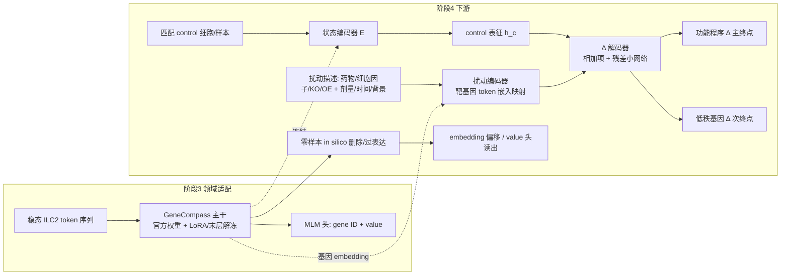

# ILC2 模型结构设计：GeneCompass 领域适配 + 扰动下游任务

日期：2026-10-14。状态：**设计文档，未实现、未训练**。遵循 CLAUDE.md 四阶段规范；本文只细化阶段 3（`src/3finetune_FM.py`）和阶段 4（`src/4downstream.py`）的模型结构，不改变已锁定的数据角色与评价规则。

## 0. 设计前已核实的事实与阻塞项

依据本机 GeneCompass 源码（`ILC2_rotation_proposal/software/GeneCompass`，与固定提交对应）：

| 项目 | 源码事实 | 对设计的影响 |
|---|---|---|
| 主干 | `BertForMaskedLM(config, knowledges)`，BERT encoder；`KnowledgeBertEmbeddings` 将 gene ID embedding 与 promoter / co-expression / gene family / PECA-GRN 四种先验 embedding、连续 value 拼接后经 `cat_fc` 投影；可选 CLS token、species embedding | 适配时这些先验 buffer 必须与 checkpoint 一致；gene token 空间是下游“扰动编码”的共享坐标系 |
| 预训练目标 | 掩码位置上 gene ID 交叉熵 + value MSE，`loss = 0.2·CE + 0.8·MSE` | post-training 沿用同一目标与权重，作为默认不改 |
| value 编码 | `ContinuousValueEncoder` 将 value 截断在 `max_value=255` | 过表达不能靠把 value 乘 10000（官方 `overexpress_index` 的做法会被截断成 255，且只改排序） |
| 官方 in silico | `perturb_delete_chipseq.py`：删除 token 或放大 value 后重排，比较 embedding 余弦相似度；`forward_pass_single_cell` 写死 `species=0`、`cuda:1` | 小鼠需 species=1；需重写为设备无关、批量化的实现 |
| 先验文件 | 本机 `prior_knowledge/*/*.pickle` 多为 133 字节 **Git LFS 指针** | **阻塞**：取得真实先验与 checkpoint 并核验 hash 前，阶段 3 不能运行 |
| 官方药物下游 | `downstream_tasks/drug_dose_response` 用 GeneCompass 基因 embedding 输入 CPA | 可借鉴“基因 embedding 作为扰动特征”，但 CPA 依赖大量单细胞药物数据，不直接照搬 |

## 1. 总体结构



核心思想：**基础模型只负责“ILC2 状态表征”与“基因坐标系”**；扰动响应由一个参数量与真实独立样本数匹配的小型 Δ 解码器学习。药物/细胞因子与基因 KO/OE 统一映射到 GeneCompass 的基因 token 空间，这是唯一能为“未见扰动”提供先验的途径，但它的有效性必须由留出评价证明，而非默认成立。

## 2. 阶段 3：GeneCompass → ILC2 领域适配

### 2.1 输入（与 checkpoint 严格对齐）

- 由阶段 2 生成：`input_ids`（按“counts / checkpoint 配套基因参考中位数”降序的基因 token，截断 2048）、`values`（配套处理后的表达值）、`length`、`species=1`。
- 归一化、log 变换、是否每细胞总量归一化均以 checkpoint 配套资产为准；未核实前不替换为 Scanpy `normalize_total`。
- 训练抽样：按 study/sample 分层，各文库等权或按 √n 加权，避免大文库主导；不把细胞数当作独立实验数。

### 2.2 可训练参数方案（按顺序比较，选模仅用内部验证）

| 方案 | 可训练部分 | 冻结部分 | 用途 |
|---|---|---|---|
| M0 原始模型 | 无 | 全部 | 必须保留的基线 |
| M1 末层解冻（CLAUDE.md 默认起步） | 最后 1–2 个 encoder 层 + LayerNorm + MLM 头（ID 头、value 头） | gene ID embedding、四种先验 embedding、`cat_fc`、前面各层 | 最简单、最易解释 |
| M2 LoRA（推荐主方案候选） | 所有层 attention 的 Q/V 低秩适配（r=8, α=16, dropout 0.05）+ MLM 头 | 原始权重全部冻结 | 参数少、可随时卸载回原模型、遗忘风险低 |
| M3 M2 + value 编码器 | M2 + `ContinuousValueEncoder` | 同 M2 | 仅当 ILC2 value 分布与预训练明显偏移时尝试 |

固定原则：

- **不更新 gene ID embedding 和先验 embedding。** ILC2 数据中大量基因（包括下游要扰动的靶基因、药物靶点）几乎不表达，若随 ILC2 数据更新，下游扰动编码所用的基因坐标会漂移且无监督约束。
- species embedding 冻结；只用小鼠，不引入新 token（如 Tissue token）。
- 可选正则：L2-SP（对 M1 的解冻层惩罚偏离原始权重），用于抑制灾难性遗忘；LoRA 方案通常不需要。

### 2.3 目标与超参数起点

- 掩码比例 15%，只在有效（非 padding）位置计算损失；沿用 `0.2·CE + 0.8·MSE`。
- 默认均匀掩码。“偏向 ILC2 程序基因的掩码”只作消融，因为它会让验证损失依赖人为基因集。
- 学习率（LoRA 约 1e-4，末层解冻约 2e-5）、warm-up（总步数 5–10%）、epoch 由实际更新步数决定；内部验证早停（patience 以验证评估次数计）。
- Small 先做资源试跑；Base 是否使用由实测决定。

### 2.4 验证（选模）与表征检查

GSE117567 是 5 个文库、每组织 1 个文库，组织 = 文库 = 批次，因此：

- `posttrain_val`：文库内细胞留出，只能称“内部验证”，用于早停与选方案。
- 组织留出（留 1 个组织训练其余 4 个）：称“组织迁移检查”，不用于选模，只报告。
- 选模指标：验证集掩码 ID 准确率/top-k、掩码 value MSE（总体与 ILC2 核心基因子集分别报告）。
- 遗忘检查（推荐）：在一个预先固定、不参与任何训练的非 ILC2 小鼠免疫参考集上比较 M0 与适配模型的掩码损失；若显著变差需说明。
- 表征报告（不用于选模）：cell embedding（CLS 与非 padding 基因 token 平均池化两种）的 kNN 组织/状态一致性、批次混杂度量，与 PCA、M0 对比。

### 2.5 输出

`model/posttrained/<run>/`：LoRA adapter 或解冻层权重、合并后权重（可选）、config、先验与词表 hash、数据版本、超参数、训练/验证曲线、M0 对照表。

## 3. 阶段 4：下游任务结构

### 3.1 状态编码器 E（冻结）

- 单细胞：每个高可信 ILC2 → cell embedding；再按真实 animal/pool **平均**得到样本级 `h_c`（同时保留细胞级 embedding 用于异质性分析）。
- Bulk：纯化 ILC2 bulk counts 作为一条“伪细胞”序列输入存在域偏移（深度、无掉零），默认**不**直接输入；bulk 研究的 control 表征改用训练集固定的程序分数/PCA。若要测试 bulk→GeneCompass，作为单独消融报告。
- 降维：`h_c`（768 维）用**仅由下游训练来源拟合**的 PCA 投到 16 维，不学习投影矩阵（样本量不足以学习 768×d 的权重）。

### 3.2 扰动编码器：统一映射到基因 token 空间

每个扰动 p 表示为：`e(p) = Σ_g s_g · w_g · G[g]  ⊕  c(p)`

- `G[g]`：GeneCompass 冻结的基因 token 输入 embedding（含先验）；也可用 control 细胞中该基因的上下文 embedding 平均，两者作消融。
- `s_g`：方向（激动/过表达 +1，拮抗/抑制/敲除 −1）；`w_g`：权重（默认等权）。
- `c(p)`：上下文向量——log 剂量（仅有剂量系列时）、时间分段（早期 3–6h / 晚期或体内）、培养底液（IL7、IL2+IL7、体内）、组织 one-hot（仅在跨组织有共同刺激覆盖时）。
- 组合扰动：各成分编码相加（多热），交互只由残差项表达。

靶基因映射表（需在 `configs/4downstream.json` 中逐条带来源锁定，以下为待核实示例）：

| 扰动 | 类型 | 映射靶基因（小鼠） | 方向 | 数据来源 |
|---|---|---|---|---|
| IL-33 | alarmin | Il1rl1, Il1rap | + | GSE136154, GSE131996, GSE102299 |
| IL-25 | alarmin | Il17rb, Il17ra | + | GSE124880, GSE102299 |
| TSLP | alarmin | Crlf2, Il7r | + | 仅人芯片 GSE45458，暂无可用小鼠 RNA-seq |
| NMU | 神经肽 | Nmur1 | + | GSE102299, GSE131996, GSE101624 |
| CGRP | 神经肽 | Calcrl, Ramp1 | + | GSE136154, GSE124880, GSE131996 |
| Yoda1 | 小分子 | Piezo1 | + | GSE255881 |
| Melatonin | 小分子 | Mtnr1a, Mtnr1b | + | GSE327373 |
| SC57461A | 小分子 | Lta4h | − | GSE304475（待核实） |
| Batf / Bcl11b / Vsir / Dusp2(PAC1) KO | 基因 | 对应基因自身 | − | GSE149854 / GSE131082, GSE67437 / GSE271999 / GSE272723 |
| E47 诱导 | 基因 OE | Tcf3 | + | GSE151504 |

限制：受体映射只编码“作用入口”，不包含下游信号强度、剂量-效应与细胞内通路差异；小分子仅有 1 个研究，不能用于训练其通用编码。化学结构指纹（RDKit Morgan）只在获得 ≥ 数十个化合物的 ILC2 数据后才考虑。

### 3.3 Δ 解码器

主终点为预先锁定的 8–12 个功能程序分数变化 Δz；次终点为低秩基因 Δ（训练折 PCA 前 10 个主成分，重建只称低秩近似）。

```
Δẑ = Σ_k p_k · β_k                      # 相加项：每个已见成分的平均效应
   + g_θ(h_c, e(p), c) − g_θ(h_c, 0, c)  # 残差：无扰动时恒为 0
```

- `β_k`：每个已见扰动成分的线性效应（Ridge 约束）；对未见扰动，`β` 由 `e(p)` 的线性映射给出（`β = W·e(p)`，W 在训练成分上拟合），这是零样本泛化的唯一通道。
- `g_θ`：单隐藏层 8–16 单元 MLP，输入 `[PCA16(h_c), PCA16(e(p)), c]`，数百参数级；L2 + 早停；不做大规模超参搜索。
- 损失：按独立样本等权的 Huber/MSE；研究/条件等权。

模型阶梯（必须全部报告）：零变化 → 平均响应 → 单刺激相加 → Ridge（程序/PCA 输入）→ Ridge（GeneCompass `h_c` 输入，M0 vs 适配模型）→ 本解码器。只有在成组留出中稳定优于相加/Ridge 时才称“非线性收益”。

### 3.4 零样本 in silico 分支（基因 KO/OE）

1. **删除**：从 control 细胞序列中移除目标 token（同时移除对应 value），重新截断/补齐。
2. **过表达**（替代官方乘 10000 的做法）：将目标基因插入或移至排序首位，value 设为该细胞 value 的最大值或训练来源中该基因的 99 百分位（≤255），二者作敏感性分析。
3. 读出：
   - 细胞 embedding 偏移（余弦/欧氏），以及向参考状态（如 IL-33 激活 vs 静息 ILC2 质心）的投影移动；
   - **value 头读出（探索性）**：扰动后逐基因掩码，用 value 头预测其表达，与未扰动预测相减得到伪表达 Δ，再汇总到功能程序。
4. 对照：随机表达量匹配的基因删除（零分布）、非表达基因删除。
5. 外部校验：与真实 KO 数据（Batf、Bcl11b、Vsir、Pac1、三重受体缺失 GSE117470）的程序方向比较；结论只称“模型敏感性与真实 KO 方向的一致性”，不称已预测 KO 表达响应。

### 3.5 各任务的数据、划分与可声明的结论

| 任务 | 训练/评价数据 | 划分 | 能声明的 | 不能声明的 |
|---|---|---|---|---|
| T1 表征评价 | GSE117567 外的独立 ILC2（representation_test，先锁定） | 研究级 | 适配表征是否优于 PCA/M0 | 学会扰动响应 |
| T2 神经肽/alarmin 组合预测（主任务） | GSE136154 bulk；GSE124880 bulk；GSE102299 sc pseudobulk；GSE131996（获得 counts 后） | 留完整组合条件；留整研究（control 可作推理输入） | 已见成分的未见组合能否由相加/残差预测 | 任意新细胞因子零样本预测 |
| T3 药物扰动（小分子） | GSE255881、GSE327373、GSE304475 | 每个研究整体作外部测试；不参与训练 | 靶基因映射的零样本方向是否吻合 | 已建立通用药物响应模型 |
| T4 基因 KO/OE | 零样本 in silico（全部）；监督仅作留一 KO 研究的探索 | 每个 KO 研究整体留出 | in silico 敏感性与真实 KO 方向一致性 | 经过验证的任意基因 KO 表达预测 |
| T5 sc→bulk 外部评价 | sc 预测按 sample/pool 聚合 vs 纯化 ILC2 bulk | 物种/组织/条件/时间匹配的研究内变化量 | 研究内响应方向一致 | 把组织 bulk 当纯 ILC2 真值 |

## 4. 规模与可识别性约束

- T2 的独立观测：GSE136154 去技术重复后 16 个条件×时间×重复观测，GSE124880 13 个 bulk 文库，合计仍只有数十个；这决定了解码器只能是 Ridge 级到数百参数级。
- 训练中只出现单刺激时，组合交互不可识别；残差项此时退化为 0 是正确行为，不应被解读为“学到相加”。
- 刺激与研究完全绑定时，其效应与批次不可分离，只做研究内效应与跨研究方向复现。
- 负对照：扰动标签置换、去掉 `e(p)`、仅 control 输入。若性能不降，则无刺激特异性学习的证据。

## 5. 代码落点（实现时）

| 文件 | 模块 |
|---|---|
| `src/3finetune_FM.py` | `load_checkpoint_and_priors`（LFS 指针检查、hash、缺失/多余权重报告）、`apply_adaptation(model, mode)`（M1/M2/M3）、`smoke_test`（真实小批次前向/反向/保存/重载）、`train`、`embed_cells(pooling)` |
| `src/4downstream.py` | `encode_controls`、`PerturbationEncoder`（读取靶基因映射表）、`DeltaDecoder`、`baselines`（零变化/平均/相加/Ridge）、`in_silico_perturb`（delete/overexpress，species=1，设备无关）、`evaluate`（程序 Δ、方向、置换） |
| `configs/3finetune_FM.json` | 新增 `adaptation_mode`、`lora_rank`、`lora_alpha`、`lora_targets`、`freeze_gene_and_prior_embeddings: true`、`pooling` |
| `configs/4downstream.json` | 新增 `perturbation_target_map`（含来源）、`program_gene_sets`（锁定版本）、`decoder_hidden`、`pca_dims` |

## 6. 实施顺序与门槛

1. 取得真实 checkpoint 与先验（替换 LFS 指针），核验 hash、词表、维度；修正 species=1 后在真实小批次上完成 M0 前向与 cell embedding。
2. 阶段 2 完成后跑 M1、M2 的资源试跑和内部验证；锁定方案后输出 M0 vs 适配模型对照。
3. 先做 T1 与 T4 的零样本 in silico（不需要扰动训练数据）。
4. 下载并审计 GSE136154 / GSE124880 bulk 后实现基线阶梯与 T2；解码器仅在基线完成后加入。
5. T3、T5 作为锁定模型后的外部评价。

每步按 CLAUDE.md 的完成标准记录输出、参数、来源与检查；随机模型或 `--help` 不计为完成。
